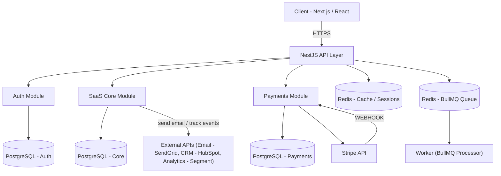
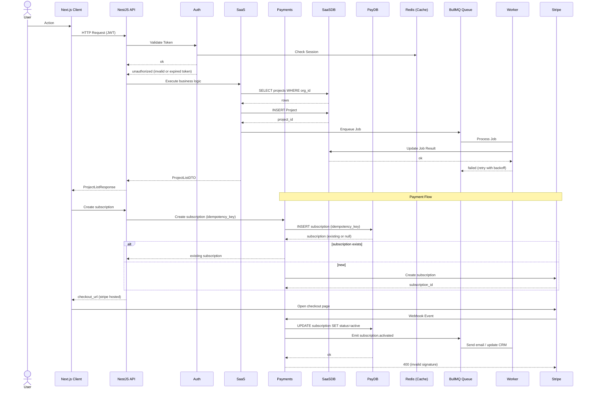

# SaaS Management Platform

SaaS Management Platform developed for managing organizations, users, and business operations in multi-tenant environments, providing access control, asynchronous processing, and integration with external services.

<br/>

> [!NOTE]
> MVP is currently under development. This README describes the intended architecture and capabilities, not completed functionality.

<br/><br/>


---

## Overview

This Platform is a production-oriented full-stack application designed to demonstrate modular backend architecture, relational domain integrity, secure multi-tenant operations, resilient payment synchronization, and operational engineering practices.

Organizations manage members, isolated workspaces, projects, subscriptions, and plan-based entitlements. Authenticated identities, tenant memberships, business-resource ownership, billing ownership, and purchasing actors are distinct concepts.

<br/><br/>


---

## Architecture

The application follows a modular monolith architecture where each domain owns its business rules and persistence interfaces while sharing controlled infrastructure. The first deployment uses one PostgreSQL database with logical domain ownership, Redis for recomputable cache and expirable infrastructure data, and PostgreSQL-backed durable jobs.

<br/>

### System diagram:


---

### Request Flow diagram:


Checkout completion, payment confirmation, subscription activation, and authorization to use paid features are separate lifecycle decisions. Stripe webhooks are signature-verified, durably recorded, reconciled, and processed idempotently.

<br/><br/>


---

## Features

### Authentication:
- JWT-based access authentication
- OAuth integration with Google and GitHub
- Refresh-token rotation and reuse detection
- Persistent session management and revocation

### Authorization:
- Role-Based Access Control (RBAC)
- Organization memberships and organization-level permissions
- Workspace-scoped access policies
- Resource ownership and tenant isolation
- Entitlement-aware authorization

### Business Logic:
- Organization-based multi-tenant architecture
- Users, memberships, workspaces, and projects
- User-owned billing accounts and subscriptions
- Stripe-hosted subscription checkout and billing reconciliation
- Subscription plans, feature entitlements, and usage limits
- Email, CRM, and analytics integrations
- Auditable business and security operations

### Performance:
- Deterministic cursor pagination
- Tenant-scoped optimized database queries and indexing
- Redis caching with explicit invalidation rules
- Concurrency-safe quota and billing operations
- Durable asynchronous job processing with retries and recovery

### Infrastructure:
- Dockerized API, worker, and supporting infrastructure
- GitHub Actions CI/CD pipelines
- Automated unit, integration, security, and end-to-end testing
- OpenAPI documentation
- Health checks, structured logging, metrics, and tracing

<br/><br/>


---

## Technology Stack

<div align="center">

| Category | Technologies |
|-----------|--------------|
| Frontend | React, Next.js |
| Backend | Node.js, NestJS |
| Database | PostgreSQL |
| ORM | Drizzle ORM |
| Cache | Redis |
| Queue | BullMQ |
| Authentication | JWT, OAuth |
| Payments | Stripe |
| Documentation | OpenAPI / Swagger |
| Testing | Jest, Playwright |
| Infrastructure | Docker, GitHub Actions |
| Deployment | Railway, Vercel |

</div>

<br/><br/>


---

## Installation:
```bash
git clone https://github.com/DexxterGWM/saas-management-platform.git
cd saas-management-platform
npm install
```

<br/><br/>


---

## Repository
[saas-management-platform](https://github.com/DexxterGWM/saas-management-platform) - Made by: [@DexxterGWM](https://github.com/DexxterGWM)

<br/><br/>


---

## License

This project is intended for educational purposes and portfolio demonstration.

Built to explore production-ready software architecture, scalable backend development, and modern SaaS engineering practices.
